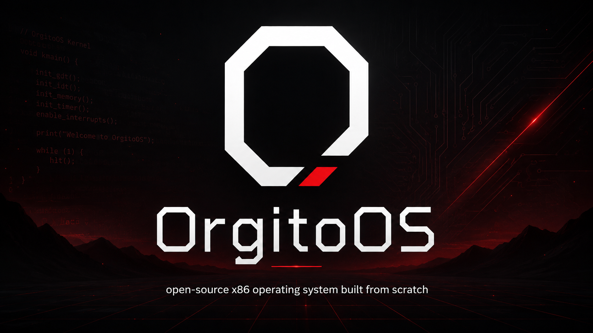

# OrgitoOS - Advanced Research Kernel

OrgitoOS is a research-oriented, open-source operating system built from scratch for the x86 architecture. It features a **modular monolithic architecture**, complete exception handling, memory management, and timer support - a production-ready foundation for OS research and experimentation.

The goal is to build a small, understandable OS **from zero**, inspired by hobby OS projects like MyraOS, xv6, and OSDev examples — but implemented with **our own code**, fully documented, and open for community contribution.

##  Mission
To create a collaborative OS development environment where researchers, academics, and low-level system developers can explore:

- How CPUs boot an OS  
- What a kernel actually does  
- How memory, interrupts, and drivers work  
- How processes and syscalls operate  
- How filesystems and user programs work  

All with clean, simple, modern C + Assembly code in a **well-organized modular structure**.

##  Architecture

OrgitoOS follows a **modular monolithic kernel architecture**:

```
├── arch/x86/          # Architecture-specific code (IDT, ISR, PIC, exceptions)
├── kernel/            # Core kernel (initialization, panic handling)
├── kernel/cpu/        # CPU simulation (pipeline, single-cycle, performance)
├── memory/            # Memory management (PMM, VMM, heap, cache, bus)
├── drivers/           # Hardware drivers (console, keyboard, timer)
├── fs/                # File systems (VFS - future)
├── process/           # Process management (future)
├── benchmarks/        # Performance benchmarks and test programs
└── include/           # Common headers (types, multiboot)
```

**Benefits**:
- ✅ Clear separation of concerns
- ✅ No circular dependencies
- ✅ Easy to navigate and understand
- ✅ Scalable for future growth
- ✅ Industry-standard organization

See [docs/architecture/ARCHITECTURE.md](docs/architecture/ARCHITECTURE.md) for detailed architecture documentation.

##  Features

### Phase 0 - Core Foundation (✅ Complete)
- ✅ **Modular monolithic architecture** - Clean separation of concerns
- ✅ **Multiboot-compatible 32-bit kernel** - GRUB bootloader support
- ✅ **VGA text output** - 80x25 color text mode via console driver
- ✅ **Complete exception handling** - All 32 x86 CPU exceptions with detailed crash reports
- ✅ **Interrupt handling** - IDT, ISRs, IRQs with PIC management
- ✅ **Physical memory manager (PMM)** - Bitmap-based page frame allocator
- ✅ **Virtual memory manager (VMM)** - Two-level paging, page tables, TLB management
- ✅ **Timer driver (PIT)** - Programmable Interval Timer at 100 Hz
- ✅ **Keyboard driver** - PS/2 keyboard with line buffering
- ✅ **VirtualBox automation** - Automated VM creation and ISO deployment
- ✅ **CPU Architecture Simulator** - 5-stage pipeline, single-cycle CPU, cache, and bus simulation

### Phase 0.5 - CPU Simulation Framework (✅ Complete)
- ✅ **5-Stage Pipelined CPU** - IF/ID/EX/MEM/WB with hazard detection
- ✅ **Single-Cycle CPU** - Reference implementation for comparison
- ✅ **Direct-Mapped Cache** - 256 lines, 32-byte blocks, hit/miss tracking
- ✅ **Memory Bus Simulator** - 64-bit width, 800 MHz, latency modeling
- ✅ **Performance Counters** - CPI, MIPS, cache statistics
- ✅ **Benchmark Suite** - Compare pipeline vs single-cycle performance

### Phase 0.6 - Coreutils-style Shell Commands (✅ Complete)
- ✅ **`ls`** - List directory contents with flags: `-a` (show dotfiles), `-l` (long format), `-R` (recursive), `-h` (help)
- ✅ **`cat`** - Display file contents with flags: `-n` (line numbers), `-h` (help), multiple file support
- ✅ **`stat`** - Show file/directory metadata: name, type, size, inode number

### Phase 1 - Process Management (✅ Complete)
- ✅ **Process control blocks** - PID/PPID, state, priority, kernel/user stacks (`process/process.h`)
- ✅ **Context switching** - Callee-saved register switch on the kernel stack (`arch/x86/context.S`)
- ✅ **Multilevel round-robin scheduler** - 3 priority levels with anti-starvation aging, 50ms quantum (`process/scheduler.c`)
- ⚠️ **Ring 3 user mode** - GDT/TSS-based privilege transitions (`arch/x86/gdt.c`, `context.S`); IRET into ring 3 and the first syscall both work, but the `forktest`/`user`/`counters` shell commands crash with an Invalid Opcode exception shortly after — a real, unresolved bug in ring-3 execution under real (non-single-stepped) interrupt timing, not a scheduler/race issue (both of those were checked and ruled out)
- ✅ **System calls** - `int 0x80` gate with `exit`/`write`/`getpid`/`fork`/`yield`/`sleep`/`getppid`/`wait` (`kernel/syscall.c`)
- ✅ **Kernel heap allocator** - `kmalloc`/`kfree` first-fit free list (`memory/heap.c`)
- ⚠️ **Shell process commands** - `ps`, `kill`, `spawn`, `sched`, `psleep` work; `forktest`, `user`, `counters`, `uecho` launch a ring-3 process but currently crash it (see above) (`kernel/proc_commands.c`)
- ✅ **`read()` syscall** - ring 3 processes can now read a line of keyboard input via `int 0x80` (`kernel/syscall.c`, `include/usyscall.h`), demoed by the `uecho` shell command

### POSIX File I/O & strace (✅ Complete)
- ✅ **`open`/`read`/`write`/`close` syscalls** - per-process file descriptor tables (0/1/2 = stdin/stdout/stderr, first file gets fd 3), Linux errno values, atomic `O_CREAT|O_EXCL`, partial writes at the 4 KiB VFS file cap (`kernel/fileio.c`)
- ✅ **`strace`** - traces `openat/read/write/close` made through `int 0x80`, in strace's own output format, with `-o file` and `-e trace=...`
- ✅ **`FileCopy`** - `userland/FileCopy.c`, a portable POSIX program that builds unchanged for OrgitoOS and Linux
- ✅ **Shell additions** - `chmod`, `cmp`, `whoami`, `layout full|split`, `uname -r`, `cmd1 && cmd2`
- 📄 Course assignment write-up (Albanian): [docs/assignments/detyre1](docs/assignments/detyre1/README.md)

### Phase 2 - Address Space Isolation & Further Hardening (In Progress)
- ✅ **Per-process page directories** with private, non-shared physical user stacks
- ✅ **Kernel/user memory protection** - the identity map is supervisor-only by
  default; only the kernel's `.text` stays `PTE_USER` (ring 3 "processes" are
  kernel-linked functions with no `exec()` yet), so kernel heap, the process
  table (PCBs), and other processes' kernel stacks are no longer reachable from
  ring 3. Ring-3 faults now kill just the offending process instead of halting
  the whole system (`memory/vmm.c`, `arch/x86/exceptions.c`)
- 🔲 Real networking (packet TX/RX, socket send/receive — currently stubs)
- 🔲 SMP Application Processor bring-up (CPU detection works; APIC-driven boot does not)
- 🔲 Shell pipe redirection between commands
- 🔲 `exec()` - user code is still kernel-linked function pointers, not loaded binaries
- And more! See [roadmap.md](docs/roadmap/roadmap.md)

##  Quick Start

### Build and Run (QEMU)

```bash
make run
```

You should see:

```
OrgitoOS - Advanced Research Kernel
====================================
Running in 32-bit protected mode.

[1/5] Initializing IDT...
[2/5] Installing exception handlers...
[3/5] Initializing PIC...
[4/5] Initializing timer...
[5/5] Initializing keyboard...

*** System Ready ***
- Exception handling: Active
- Timer interrupts: 100 Hz
- Keyboard: Ready

Type commands and press Enter!

OrgitoOS> _
```

### Build Bootable ISO

```bash
make iso
```

### Run in VirtualBox

```bash
make run-vbox
```

This automatically creates a VM, builds an ISO, and launches OrgitoOS in VirtualBox!

### Run CPU Architecture Benchmark

```bash
make benchmark
```

This runs a comprehensive benchmark comparing the 5-stage pipelined CPU against the single-cycle CPU model:

```
OrgitoOS CPU Architecture Simulator
==================================

=== Pipelined CPU Benchmark ===
Instructions executed: 8192
Total cycles: 10245
Pipeline stalls: 2048
CPI: 1.251
MIPS: 799.61

=== Single-Cycle CPU Benchmark ===
Instructions executed: 8192
Total cycles: 8192
CPI: 1.000
MIPS: 1000.00

=== Cache Performance Benchmark ===
Cache hits: 3316, Cache misses: 6684
Hit rate: 33.16%

=== Memory Bus Performance ===
Bus frequency: 800 MHz, Memory latency: 24 cycles (30.0 ns)
Throughput: 6103.52 MB/s
```

See [kernel/cpu/README.md](kernel/cpu/README.md) for detailed documentation on the CPU simulator.

## 🛠️ Build & Run

### Prerequisites
To build and run OrgitoOS, you'll need:

- **gcc** with 32-bit support (or i686-elf-gcc cross-compiler)
- **nasm** (if you plan to extend the assembly code)
- **make**
- **qemu-system-i386** (for testing with QEMU)
- **grub-pc-bin**, **xorriso**, **mtools** (for creating bootable ISO)
- **VirtualBox** (optional, for running in VirtualBox)

#### Installing Prerequisites

**Ubuntu/Debian:**
```bash
sudo apt-get install gcc-multilib nasm make qemu-system-x86 grub-pc-bin xorriso mtools
```

**Arch Linux:**
```bash
sudo pacman -S gcc nasm make qemu-system-x86 grub xorriso mtools
```

**macOS (with Homebrew):**
```bash
brew install i686-elf-gcc nasm make qemu grub xorriso mtools
```

### Building

From the project root directory:

```bash
make
```

This will compile the kernel and produce `build/orgitoos.bin`.

### Running

#### Option 1: QEMU (Quick Testing)

To build and run the kernel in QEMU with direct kernel boot:

```bash
make run
```

This launches QEMU with the kernel. You should see:

```
OrgitoOS - Research Kernel Prototype
-------------------------------------
Running in 32-bit protected mode.
Initializing interrupts...
Keyboard initialized. Type something!

OrgitoOS> _
```

Type on your keyboard and press Enter to interact with the shell!

## Shell Commands

OrgitoOS includes a built-in shell with the following commands:

| Command | Description |
|---------|-------------|
| `help` | Display list of available commands |
| `clear` | Clear the console screen |
| `echo [text]` | Print text to the console |
| `uname` | Display OS name and version |
| `uptime` | Show system uptime |
| `pwd` | Print current working directory |
| `ls [-a] [-l] [-R] [-h] [path]` | List directory contents |
| `cd <path>` | Change current directory |
| `cat [-n] [-h] file [file...]` | Display file contents |
| `stat [-h] path` | Show file or directory metadata |
| `mkdir <name>...` | Create one or more directories |
| `touch <name>...` | Create empty file(s) |
| `write <file> <text...>` | Write text to a file (creates it if needed) |
| `rm <name>...` | Remove file(s) or directory entries |
| `meminfo` | Show physical (PMM) and kernel heap memory usage |
| `reboot` | Reboot the system |
| `ps` | List processes (pid, ppid, state, priority, cpu, name) |
| `kill <pid>` | Terminate a process by pid |
| `spawn [n]` | Launch demo kernel threads (workers) |
| `sched` | Show scheduler statistics |
| `psleep [ms]` | Sleep the shell for N ms (other processes keep running) |
| `user` | Launch a ring 3 "hello world" program (syscalls demo) |
| `forktest` | Launch a ring 3 program that `fork()`s and `wait()`s |
| `counters [n]` | Launch N ring 3 counter programs running concurrently |
| `uecho` | Launch a ring 3 program that `read()`s a line and echoes it back |

### `ls` — List Directory Contents

```
ls [-a] [-l] [-R] [-h] [path]
```

| Flag | Description |
|------|-------------|
| `-a` | Include entries starting with `.` (dotfiles) |
| `-l` | Long format: shows type (`d`/`-`), size in bytes, and name |
| `-R` | Recursively list subdirectories |
| `-h` | Show help |

**Examples:**

```
OrgitoOS> ls /
bin/  etc/  home/  tmp/

OrgitoOS> ls -l /etc
-        59  motd.txt

OrgitoOS> ls -R /
/:
bin/  etc/  home/  tmp/
/bin:
/etc:
motd.txt
/home:
/tmp:
```

### `cat` — Display File Contents

```
cat [-n] [-h] file [file...]
```

| Flag | Description |
|------|-------------|
| `-n` | Number all output lines |
| `-h` | Show help |

**Examples:**

```
OrgitoOS> cat /etc/motd.txt
Welcome to OrgitoOS!
This is a test file in the filesystem.

OrgitoOS> cat -n /etc/motd.txt
     1  Welcome to OrgitoOS!
     2  This is a test file in the filesystem.
```

### `stat` — Show File Metadata

```
stat [-h] path
```

**Example:**

```
OrgitoOS> stat /etc/motd.txt
  File: motd.txt
  Type: regular file
  Size: 59 bytes
 Inode: 6

OrgitoOS> stat /etc
  File: etc
  Type: directory
  Size: 0 bytes
 Inode: 2
```

##  Phase 0 Implementation Details

OrgitoOS Phase 0 includes complete implementations of:

- **Exception Handling** - All 32 x86 exceptions with detailed crash reports showing registers, error codes, and faulting addresses
- **Physical Memory Manager** - Bitmap-based allocator supporting up to 4GB RAM
- **Virtual Memory Manager** - Complete two-level paging with page tables, TLB management, and region mapping
- **Timer Driver** - PIT configured at 100 Hz for future scheduling
- **Enhanced Kernel** - Clean boot messages, progress indicators, and modular design

For complete implementation details, see [docs/roadmap/UPGRADE_PHASE0.md](docs/roadmap/UPGRADE_PHASE0.md).

##  Testing Exception Handling

Want to see the exception handler in action? Add this to kernel.c:

```c
void test_exception(void) {
    volatile int x = 1 / 0;  // Trigger divide-by-zero
}
```

You'll get a detailed crash report with full register dump!

#### Option 2: VirtualBox (Full Emulation)

To create a bootable ISO and run in VirtualBox:

```bash
make run-vbox
```

This will:
1. Build the kernel
2. Create a bootable ISO image with GRUB (`orgitoos.iso`)
3. Create and configure a VirtualBox VM
4. Start the VM with the ISO attached

**Manual VirtualBox Setup:**

If you prefer to set up VirtualBox manually:

1. Create the ISO image:
   ```bash
   make iso
   ```

2. Create a new VirtualBox VM:
   - Name: OrgitoOS
   - Type: Other
   - Version: Other/Unknown
   - Memory: 512 MB (minimum)
   - No hard disk needed

3. Configure the VM:
   - System → Boot Order: CD-ROM first
   - System → Enable I/O APIC
   - Storage → Add IDE Controller
   - Storage → Attach `orgitoos.iso` as CD-ROM

4. Start the VM and enjoy!

**Troubleshooting:** If you encounter any issues with VirtualBox, see the [VirtualBox Troubleshooting Guide](docs/virtualization/VIRTUALBOX_TROUBLESHOOTING.md).

#### Option 3: ISO in QEMU

To test the ISO image in QEMU:

```bash
make run-iso
```

### Debugging with QEMU + GDB

OrgitoOS ships with a `make debug` target that starts QEMU paused with a GDB
server enabled so you can attach a debugger before any kernel code runs.

**Terminal 1 – start QEMU in debug mode:**

```bash
make debug
```

**Terminal 2 – attach GDB:**

```bash
make gdb
```

Then in GDB:

```
(gdb) continue       # resume kernel execution
(gdb) Ctrl+C         # interrupt to inspect state
(gdb) info registers # view CPU registers
```

For a full reference including QEMU logging (`make qemu-log`) and useful GDB
commands, see [docs/debugging.md](docs/debugging.md).

### Cleaning

To remove build artifacts:

```bash
make clean
```

## 🌐 GitHub Pages Website

The project website is hosted on **GitHub Pages** and lives in the `docs/` directory of this repository.

### Live URL

```
https://orgito1015.github.io/OrgitoOS/
```

*(This repository's remote is `github.com/orgito1015/OrgitoOS` — the Pages URL
must match the current repo name. An older name, `My-Operating-System-OpenOS`,
used to be linked here and pointed at a repo that no longer exists.)*

### Enable GitHub Pages (repository owner)

1. Go to **Settings → Pages** in this repository.
2. Under **Build and deployment**, set:
   - **Source**: `Deploy from a branch`
   - **Branch**: `main`
   - **Folder**: `/docs`
3. Click **Save**.

GitHub will publish the site within a minute or two. The URL above will go live once Pages is enabled.

### Repository layout

| Path | Purpose |
|------|---------|
| `docs/index.html` | GitHub Pages landing page |
| `docs/404.html` | Custom 404 page |
| `docs/assets/style.css` | Website stylesheet |
| `docs/architecture/` | Architecture documentation (Markdown) |
| `docs/roadmap/` | Roadmap documentation (Markdown) |
| `kernel/`, `arch/`, `memory/`, `drivers/` | OS source code |
| `Makefile` | Build system |

> **Note:** The `docs/` folder serves dual purpose — it hosts the GitHub Pages website (`index.html`, `404.html`, `assets/`) **and** the project's Markdown documentation (subdirectories like `architecture/`, `roadmap/`, etc.). OS source code lives outside `docs/` in directories such as `kernel/`, `arch/`, `memory/`, and `drivers/`.

---

##  Contributing

OrgitoOS welcomes contributions at all levels! Whether you're fixing a bug, adding a feature, improving documentation, or just learning, your contributions are valuable.

Please see [CONTRIBUTING.md](CONTRIBUTING.md) for detailed guidelines on:
- How to submit contributions
- Coding standards and style guidelines
- Testing procedures
- Areas where help is needed

### Quick Start for Contributors

1. Fork the repository
2. Create a feature branch (`git checkout -b feature/amazing-feature`)
3. Make your changes and test them
4. Commit with clear messages (`git commit -m "Add amazing feature"`)
5. Push to your fork (`git push origin feature/amazing-feature`)
6. Open a Pull Request

## Documentation

The `/docs` directory contains comprehensive documentation organized by topic:

- **[Documentation Index](docs/README.md)** - Complete documentation guide and structure
- **Architecture**: System design and implementation details
  - [Architecture Overview](docs/architecture/ARCHITECTURE.md) - Modular monolithic architecture
  - [System Overview](docs/architecture/system_overview.md) - Boot process and memory layout
  - [Advanced Features](docs/architecture/ADVANCED_FEATURES.md) - IPC, SMP, GUI, networking, scripting
  - [VFS Implementation](docs/architecture/VFS_IMPLEMENTATION.md) - In-memory filesystem details
- **Roadmap**: Development plans and milestones
  - [Roadmap](docs/roadmap/roadmap.md) - Current status and future development plans
  - [Phase 0 Completion](docs/roadmap/UPGRADE_PHASE0.md) - Foundation implementation guide
  - [Evolution Strategy](docs/roadmap/OS_EVOLUTION_STRATEGY.md) - 36-week development roadmap
- **Boot**: Bootloader and startup documentation
  - [Multiboot Fix](docs/boot/MULTIBOOT_FIX.md) - GRUB multiboot header technical details
  - [GRUB Boot Fix](docs/boot/GRUB_BOOT_FIX.md) - QEMU boot order and GRUB2 device syntax fixes
- **Drivers**: Hardware driver debugging
  - [Keyboard Fix](docs/drivers/KEYBOARD_FIX.md) - PIT/IRQ0 interrupt pipeline diagnostic
- **Virtualization**: Running OrgitoOS in VMs
  - [VirtualBox Quickstart](docs/virtualization/VIRTUALBOX_QUICKSTART.md) - Quick start guide
  - [VirtualBox Troubleshooting](docs/virtualization/VIRTUALBOX_TROUBLESHOOTING.md) - Troubleshooting guide
- **Refactoring**: Code reorganization history
  - [Refactoring Guide](docs/refactoring/REFACTORING.md) - Migration information
- **Learning**: Educational materials and progress tracking
  - [Learning Index](docs/learning/LEARNING_INDEX.md) - Current focus and completed topics
  - [Development Journal](docs/journal/DEVELOPMENT_LOG.md) - Development progress log
  - [Chapters](docs/chapters/) - Structured learning by topic

### Further Reading (OSDev Wiki)

The [OSDev Wiki](https://wiki.osdev.org/Expanded_Main_Page) is the primary external
reference this project follows. Articles most relevant to what's implemented here:

| Subsystem | This codebase | OSDev Wiki articles |
|---|---|---|
| Boot/build | `arch/x86/boot.S`, `linker.ld`, `Makefile` | [Meaty Skeleton](https://wiki.osdev.org/Meaty_Skeleton), [Multiboot](https://wiki.osdev.org/Multiboot), [Higher Half Bare Bones](https://wiki.osdev.org/Higher_Half_Bare_Bones) *(relevant since `KERNEL_VIRTUAL_BASE` is defined but unused — see roadmap)* |
| Interrupts | `arch/x86/idt.c`, `isr.S`, `pic.c` | [Interrupt Descriptor Table](https://wiki.osdev.org/Interrupt_Descriptor_Table), [Interrupts Tutorial](https://wiki.osdev.org/Interrupts_tutorial), [Programmable Interval Timer](https://wiki.osdev.org/Programmable_Interval_Timer), [PS/2 Keyboard](https://wiki.osdev.org/PS/2_Keyboard) |
| Memory | `memory/pmm.c`, `memory/vmm.c` | [Memory Management](https://wiki.osdev.org/Memory_Management), [Page Frame Allocation](https://wiki.osdev.org/Page_Frame_Allocation), [Paging](https://wiki.osdev.org/Paging) |
| Processes | `process/`, `arch/x86/context.S`, `gdt.c` | [Kernel Multitasking](https://wiki.osdev.org/Kernel_Multitasking), [Context Switching](https://wiki.osdev.org/Context_Switching), [Getting to Ring 3](https://wiki.osdev.org/Getting_to_Ring_3), [Going Further on x86](https://wiki.osdev.org/Going_Further_on_x86) |
| Filesystems | `fs/vfs.c` (ramfs) | [VFS](https://wiki.osdev.org/VFS), [Ext2](https://wiki.osdev.org/Ext2) *(natural next step beyond ramfs)* |

##  Project Stats

- **Lines of Code**: ~2,400 (kernel + documentation)
- **Source Files**: 33 (organized in 7 directories)
- **Exception Handlers**: 32 (all x86 exceptions)
- **Memory Management**: PMM + VMM (fully implemented)
- **Drivers**: Console (VGA), Keyboard (PS/2), Timer (PIT)
- **Supported Platforms**: QEMU, VirtualBox, Bochs
- **Documentation**: 20,000+ lines (including architecture docs)

## License
MIT License — free to use, modify, and contribute.
